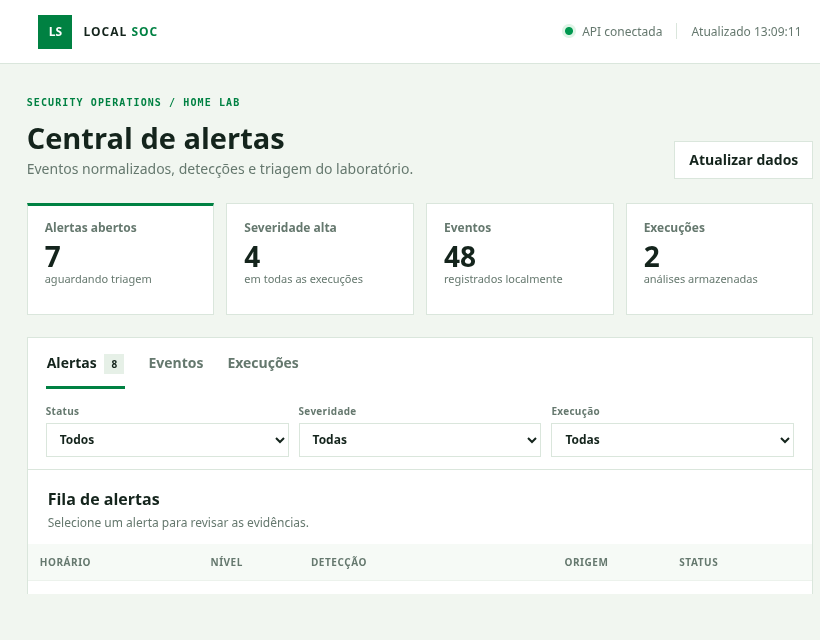
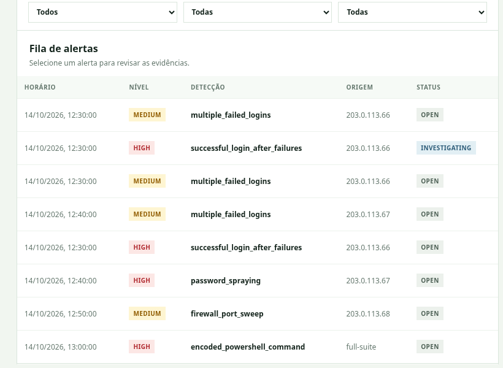

# SOC Home Lab

A local, reproducible SOC training lab for practicing event normalization, deterministic detection rules, persistence, alert monitoring, and analyst triage. The simulator creates synthetic records only; it does not capture packets or contact external hosts.

[Português](README.md) | **English**

## Dashboard screenshots





## Architecture

`synthetic JSONL -> rules -> SQLite -> FastAPI <-> static web console`

The independent HTML/CSS/JavaScript frontend consumes the FastAPI JSON API. The API and CLI use a local SQLite database by default. No Node.js build step is required.

## Detection rules

| Rule | Default condition | Severity |
| --- | --- | --- |
| `multiple_failed_logins` | 5 failed logins from one IP within 10 minutes | medium |
| `successful_login_after_failures` | 5 failures for the same IP/account followed by success within 5 minutes | high |
| `password_spraying` | Failures against 5 distinct accounts from one IP within 10 minutes | high |
| `firewall_port_sweep` | Denied connections to 10 distinct ports within 10 minutes | medium |
| `encoded_powershell_command` | Process creation for PowerShell with an encoded-command switch | high |

These rules classify supplied events; they do not confirm a real incident by themselves.

## Setup

Requires Python 3.10 or later. FastAPI and Uvicorn are runtime dependencies. The first install needs access to the Python package index.

```bash
python3 -m venv .venv
.venv/bin/python -m pip install -r requirements.txt
.venv/bin/python -m unittest discover -s tests -v
```

Generate and analyze the full synthetic scenario:

```bash
.venv/bin/python -m soc_lab.simulator --scenario full-suite --seed 42
.venv/bin/python -m soc_lab.cli --input data/generated_events.jsonl
```

Run the API and frontend locally:

```bash
.venv/bin/python -m uvicorn soc_lab.api:app --host 127.0.0.1 --port 8000 --limit-concurrency 50 --backlog 128 --timeout-keep-alive 5
```

Open `http://127.0.0.1:8000` for the console and `http://127.0.0.1:8000/docs` for the interactive API documentation. The dashboard provides alert filters, event/run views, evidence details, and analyst triage notes/status.

## Synthetic incident report

The detailed Portuguese report is [available as a PDF](docs/reports/incident-triage-001.pdf), with its editable source in [docs/incident-triage.md](docs/incident-triage.md). It documents the `compromised` scenario with seed `2026`; no real systems or accounts were involved.

To regenerate the PDF, install its optional reporting dependency and run:

```bash
.venv/bin/python -m pip install -r requirements-report.txt
.venv/bin/python scripts/export_incident_report.py
```

## Security and deployment scope

The default configuration binds to loopback and allows only `127.0.0.1` and `localhost`. It applies request-rate and body-size limits, host validation, security headers, and parameterized SQLite queries. Rate-limit counters are in memory and local to one process. There is no user authentication or authorization.

**Do not expose this API publicly or use it for real telemetry as-is.** A public deployment needs authentication/authorization, TLS, durable managed storage, shared rate limiting, and a reviewed secret-management setup. SQLite data, generated JSONL, virtual environments, and `.env` files are excluded from Git.

## Limitations and next steps

This is not a production SIEM. It does not ingest Windows/Linux logs or live network traffic, parse TCP/UDP packets, or perform automated response. The included scenarios and reserved IP ranges are synthetic. See [docs/roadmap.md](docs/roadmap.md) for a safe path toward authorized host telemetry and optional SIEM integration.
